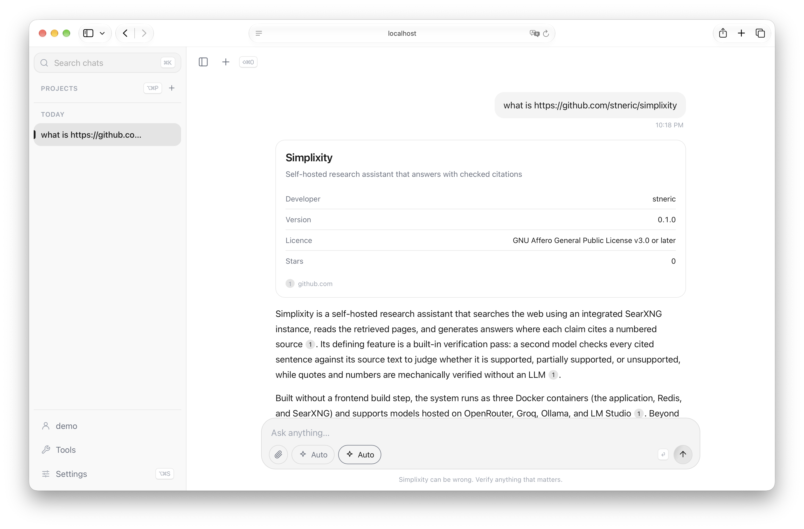
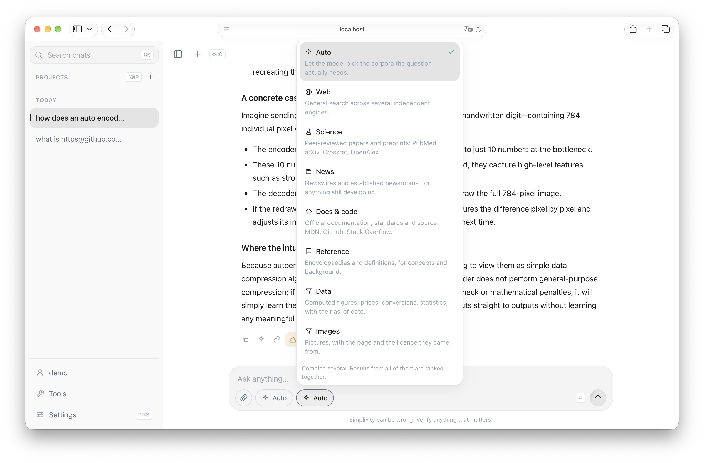
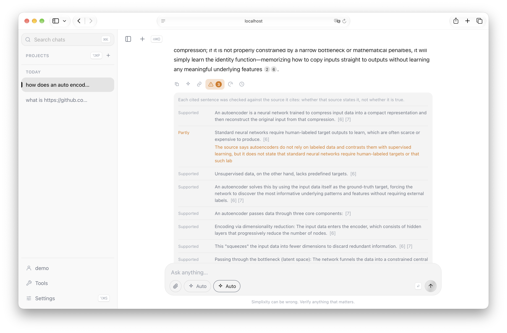
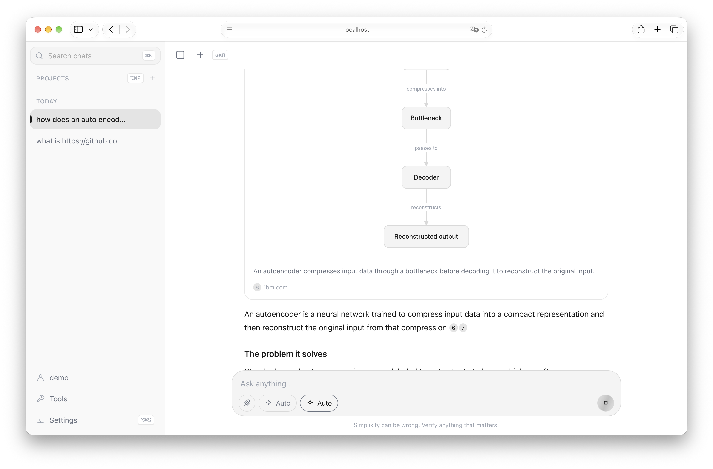
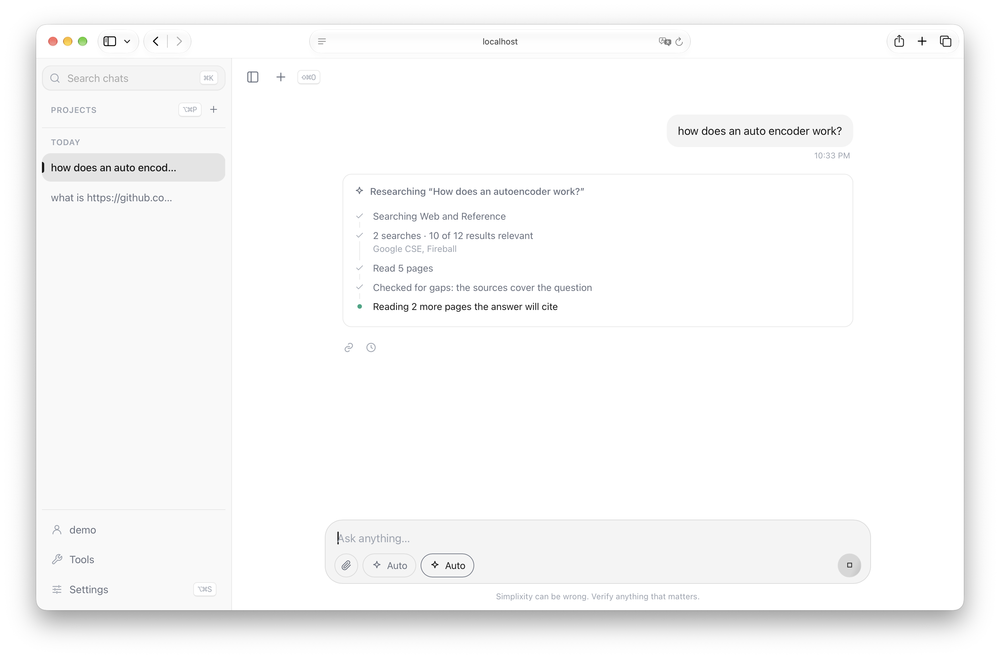
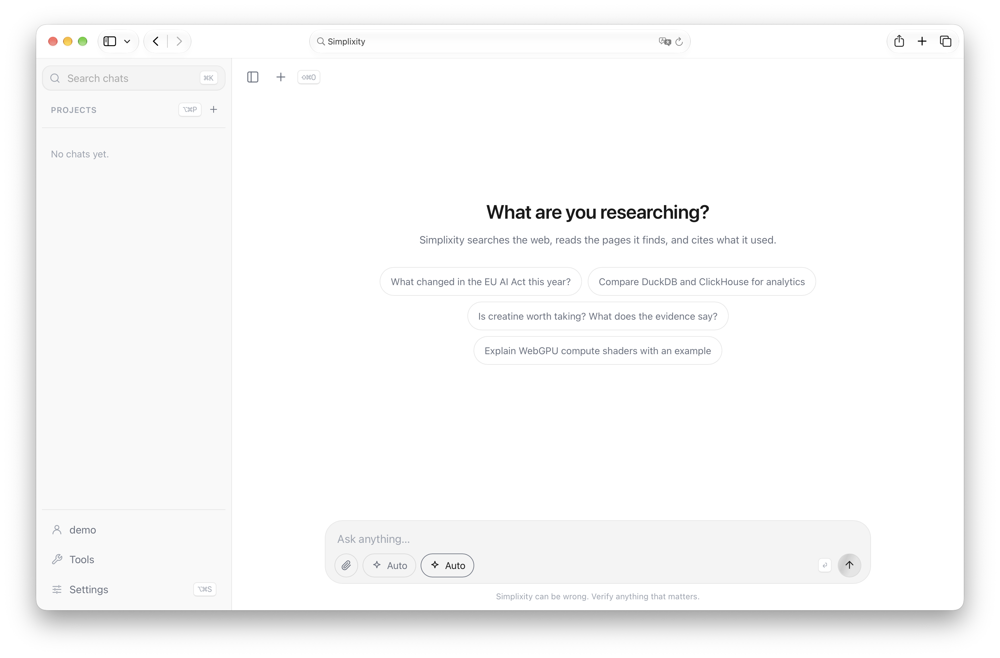
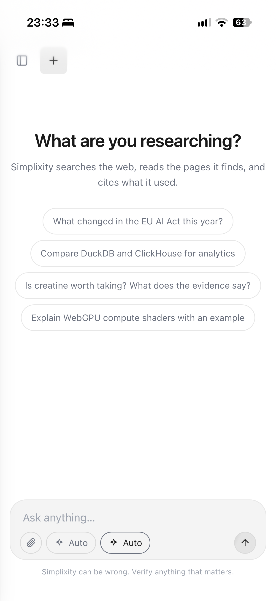
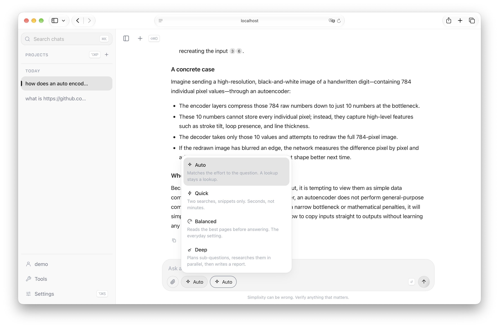

<p align="center">
  
</p>

<h1 align="center">Simplixity</h1>

<p align="center">
  <a href="https://github.com/stneric/simplixity/actions/workflows/ci.yml"></a>
  
  
  
  
  
  
  
  
  
</p>

A self-hosted (re)search assistant. You ask a question, it searches the web
through your own SearXNG instance, reads the pages it finds and writes an
answer in which every claim cites a numbered source. A second pass then checks
each cited sentence against the source it cites and shows you the result.



It runs as three containers (the app, Redis, SearXNG), works with any model on
OpenRouter, Groq, Ollama or LM Studio, and has no frontend build step.

## Features

- **Research depth that fits the question.** A greeting costs one model call,
  a weather question goes straight to a weather service, and "how does an
  autoencoder work" gets searched, read, ranked and cited. You can also pick
  Quick, Balanced or Deep yourself; the router may do less than you asked,
  never more, and the run footer says when it did.
- **Sources you can judge.** Each source is labelled by kind (official text,
  peer-reviewed paper, documentation, newsroom, ordinary page) and ranked on
  that and on how many independent engines returned it. No single domain may
  fill more than two citation slots.
- **Paste a link.** A URL in the question is read in full first, on every
  depth, and becomes source [1]. "Summarise this" is answered from the page
  alone; "what do others say about this" searches around it, with the linked
  page kept as the main subject of the answer.
- **Search lenses.** Web, Science (PubMed, arXiv, Crossref, OpenAlex, Semantic
  Scholar), News, Docs & code, and Reference, alone or combined.

  
- **Citation check.** Every cited sentence is judged *supported*, *partly* or
  *not supported* by the source it cites. Quotes and numbers are also compared
  mechanically with the source text, and anything left unchecked is counted as
  unchecked.

  
- **Literature workflow.** A separate page for building a reading list: an
  intake conversation turns into search criteria, rounds of results from
  OpenAlex, Semantic Scholar, Crossref, arXiv and IEEE Xplore are screened
  against them, your decisions steer the next round, and the result exports to
  BibTeX.
- **Chat with your PDFs.** Upload the papers of a reading list, or attach PDF,
  Word, Markdown and text files to any chat. Answers then cite page numbers,
  and a click opens the PDF on that page with the cited passage highlighted.
- **Structured answers.** Prices, forecasts, match results, comparisons,
  timelines and diagrams arrive as cards built from validated fields, each
  naming its source.

  
- **Runs survive reloads.** A run belongs to the server, not to the browser tab.
  Reload, close the laptop or lose the network, and the answer picks up where
  it was.
- **Redaction tool.** Removes names, addresses and other personal data from a
  document using a local model only, so the document never leaves the machine.
- **Profiles.** Several people can share one install with separate chats,
  projects and settings, optionally password-protected.

## How a question is answered

1. **Triage.** Plain string matching, no model call. It catches small talk
   and weather questions that name a place, and passes everything else on.
2. **Classifier.** One model call reads the question and the conversation. It
   rewrites the question so it stands on its own, writes the search queries,
   and decides how complex the question is, whether it is time-sensitive,
   which sources fit (web, science, news, docs, reference), and whether the
   answer should be prose or a card such as a table, a chart or a profile.
3. **Router.** Turns that verdict into a budget: Simple, Quick, Balanced or
   Deep. If you picked a depth yourself, it is a ceiling the router may lower
   but never raise.
4. **Lookup or research.** Anything a service can answer directly, such as a
   forecast, is fetched without searching. Otherwise the run searches through
   SearXNG, drops results that are off-topic, ranks the rest by source type,
   agreement between engines and embedding similarity, and reads the best
   pages in full. Deep splits the question into sub-questions, researches them
   in parallel and runs one more round for gaps it finds.
5. **Writer.** Writes the answer from the numbered sources, while a card, if
   the classifier asked for one, is built alongside it.
6. **Citation check.** A judge model rules on every cited sentence, and
   quotes and numbers are compared with the source text without a model.

While a run is going, each of these steps shows up live above the answer:



The classifier, the gap check and the citation check can run on a small,
cheap *router model* set in the settings, and the citation check can get a
judge model of its own; the answer itself comes from the chat model. The footer under each answer names the models, the engines that
answered, and anything the router cut.

## Quick start

You need Docker with Compose v2.24 or newer and an
[OpenRouter API key](https://openrouter.ai/keys).

```bash
git clone https://github.com/stneric/simplixity.git
cd simplixity
cp .env.example .env
```

Open `.env`, set `OPENROUTER_API_KEY`, and set `SEARXNG_SECRET` to the output of
`openssl rand -hex 32`. Then:

```bash
docker compose up -d --build
```

The app is at <http://localhost:3000>. The first start pulls SearXNG and Redis
and builds the image, which takes a minute or two. Create a profile, pick a
model in the settings, and ask something.



`curl localhost:3000/api/health` reports whether Redis, SQLite and the API key
are in place, and `docker compose logs -f simplixity` shows what
each run is doing.

### Local models

Ollama and LM Studio running on the host are discovered automatically. Without
an OpenRouter key the app still runs on them; embeddings then fall back to
keyword ranking. Note that the redaction tool requires a local model.

A model that is specialized for title generation is currently in work. Progress can be found at https://huggingface.co/stneric/simplixity-title-0.8b

### Without Docker

Python 3.12+ and [uv](https://docs.astral.sh/uv/), plus a Redis server.

```bash
uv sync
redis-server &
uv run python -m app        # http://localhost:3000
```

Search needs a SearXNG instance with JSON output enabled at `SEARXNG_API_URL`.
The one in `docker-compose.yml` is configured for this app (engine list, JSON
format, timeouts), so the easiest route is `docker compose up -d searxng` and
pointing `SEARXNG_API_URL` at it. Without SearXNG the app answers from the
model alone and says so in the answer.

## Configuration

Everything is set in `.env`; [`.env.example`](.env.example) lists every
variable with an explanation. Only two are required:

| Variable | Purpose |
|---|---|
| `OPENROUTER_API_KEY` | Chat models and embeddings. Optional if you only use local models. |
| `SEARXNG_SECRET` | Required by SearXNG. Any random string, e.g. `openssl rand -hex 32`. |

Models are not set in `.env`. The chat, router, judge, title and embedding
models are chosen in the settings and stored per profile.

### Default models

A fresh install uses these models without any setup, all on OpenRouter and
pinned to the versions that were tested, picked from nine cheap, fast models
([comparison](docs/eval/model-choice.md)). Any of them can be changed in the
settings, and a second profile starts from the first profile's choices.

| Setting | Model | Why |
|---|---|---|
| Chat model | `google/gemini-3.8-flash` | Starts writing within 2 seconds of getting its sources, cites the most sentences (87%), and 98 to 100% of what it cites holds up. |
| Router model | `anthropic/claude-haiku-5.5` | The best classifier tested (98%), at a fifth of Gemini's price. It runs before every answer. |
| Judge model | `anthropic/claude-haiku-5.5` | Let no unsupported claim through and copies the evidence word for word. It comes from a different model family than the writer, so it does not share its blind spots. |
| Embedding model | `mongodb/voyage-4-lite` | Found the right passage for every question, including German questions against English sources, as Gemini Embedding 2 did, for a tenth of its price. |

Without an OpenRouter key the router and judge step aside, and the chat model
you picked does their work.

#### What a question costs

20 questions with these defaults on depth Auto, at OpenRouter's prices of
November 2026:

| Depth Auto chose | Questions | Cost per question | Done after |
|---|---|---|---|
| Simple: a fact, the weather, small talk | 6 | $0.0006 to $0.005, median $0.004 | about 15 s |
| Balanced | 9 | $0.010 to $0.029, median $0.014 | about 1 min |
| Deep: comparisons, the state of research | 5 | $0.033 to $0.058, median $0.044 | about 2 min |

That is $0.019 per question on average, or about $1.90 per 100. Embeddings
are an eighth of it. With `google/gemini-embedding-2` the same questions cost
$0.034 on average, about half of it embeddings, and it ranked no better in the
comparison. The footer under each answer shows what that answer cost.

## Running it on a server

The compose file publishes port 3000 on `127.0.0.1` only. The app has no TLS,
and profiles keep people apart but are not hardened authentication, so put it
behind a reverse proxy, and preferably behind an access layer such as an
authenticating proxy or a VPN. I personally use Dokploy with Traefik and Cloudflare.

For Traefik (including Dokploy and Coolify), an overlay adds the network and
routing labels:

```bash
SIMPLIXITY_DOMAIN=research.example.com PROXY_NETWORK=dokploy-network \
docker compose -f docker-compose.yml -f deploy/traefik.yml up -d --build
```

Other proxies need one thing beyond a normal HTTP route: response buffering
off for `/api/runs/*/events`, which is a Server-Sent Events stream. In nginx
the app already sends `X-Accel-Buffering: no`.

The container starts as root only to fix the ownership of a bind-mounted
`/data` and then drops to uid 1000 before starting Python.

### On your phone

Once the app is reachable over HTTPS, it can be installed as an app on a
phone. Open it in the browser and choose "Add to Home Screen" (Safari's share
menu, or Chrome's menu on Android). It then opens full screen from its own
icon, without the browser's address bar.



## Research depth



| | Simple | Quick | Balanced | Deep |
|---|---|---|---|---|
| Search queries | 1 | 2 | 3 | 3 per sub-question |
| Pages read in full | 1 | 0 | 5 | 4 per sub-question |
| Sources cited | up to 6 | up to 6 | up to 10 | up to 28 |
| Sub-questions | | | | 5, plus one gap round |
| Time limit | 90 s | 90 s | 240 s | 720 s |

Simple is never offered in the menu. Auto picks it for questions one good
source can settle. The limits are budgets: time and one model call are
reserved for writing the answer, so a run that runs out of budget still
answers with what it has. The presets live in
[`app/agent/depth.py`](app/agent/depth.py) and the UI reads them from
`/api/depths`, so the menu always describes what the agent actually does.

## Documentation

- [Architecture](docs/architecture.md): how a run works, the streaming and
  block protocol, ranking, the citation check, persistence.
- [Literature and PDFs](docs/literature.md): the reading-list workflow and how
  answers from your own papers are cited and checked.
- [Contributing](CONTRIBUTING.md): setup, tests, conventions.

## Development

```bash
uv sync
uv run pytest                            # backend, no network
node --test "tests/frontend/*.test.mjs"  # frontend, no browser or npm
uv run ruff check app tests
uv run ruff format app tests
```

AI was used for refactoring, code review and debugging, and to write the tests.

## Limitations

- **One replica.** Runs live in the server process. A restart ends running
  runs with an error message, and two replicas would reap each other's runs.
- **Search quality depends on SearXNG.** A self-hosted instance scrapes the
  public engines from one IP address, and under sustained use several of them
  start answering with CAPTCHAs. The run footer lists which engines answered
  and which refused.
- **The citation check is a check, not a proof.** It asks whether the cited
  source says what the sentence claims. It cannot tell you whether the source
  is right.

## License

[GNU Affero General Public License v3.0 or later](LICENSE). If you run a
modified version as a service for others, you have to offer them its source.

pdf.js is included unmodified in `web/vendor/pdfjs` under the Apache License
2.0.
